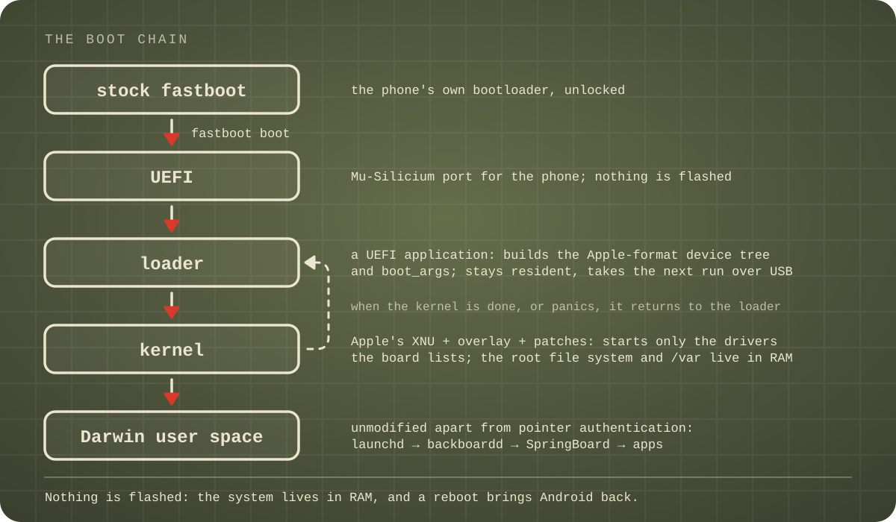

<p align="center">
  
</p>

<p align="center">
  Apple's open-source XNU kernel and the Darwin user space, on phones with Qualcomm chips.
</p>

<p align="center">
  <a href="Documentation/architecture.md">Architecture</a> · <a href="Documentation/porting.md">Porting</a> · <a href="Documentation/building.md">Building</a> · <a href="Documentation/drivers.md">Drivers</a> · <a href="https://github.com/oosexgang/xnu-kernel-qcom/tree/devices">Devices</a> · <a href="CONTRIBUTING.md">Contributing</a>
</p>

<p align="center">
  <a href="https://github.com/oosexgang/xnu-kernel-qcom/actions/workflows/check.yml"></a>
  <a href="Documentation/README.md"></a>
  <a href="https://github.com/oosexgang/xnu-kernel-qcom/tree/devices"></a>
  <a href="https://t.me/oosexgangdevs"></a>
  <a href="kernel/UPSTREAM"></a>
</p>

<p align="center">
  English | <a href="README.zh-CN.md">简体中文</a>
</p>

# HakiOS

HakiOS runs Apple's open-source XNU kernel and a Darwin user space on Android phones with Qualcomm
chips. Nothing is flashed: a UEFI is started with `fastboot boot`, the system lives in RAM, and a
reboot brings Android back.

> Experimental. Needs an unlocked bootloader. No tool here may flash, erase or write the phone's storage.

This branch is the project itself, for any phone: the kernel, the loader, the tools, the description
of each supported chip. It names no phone. A phone is a **device package**, a small directory kept on
the [`devices` branch](https://github.com/oosexgang/xnu-kernel-qcom/tree/devices), and one command
brings it into a checkout.

## What is here

- **One kernel for every board.** The board is found at boot; a driver starts only where the board's
  file lists it, so a machine nobody described is never written to.
- **Boards are data.** A phone is one file and its chip another, written as a device tree source is
  (`board.dts`, `soc.dtsi`). Addresses, pins, firmware
  directories and boot defaults live there, not in the drivers. A tool starts both files from the
  phone's Android device tree and says what can be turned on next.
- **Device packages.** Phones are kept apart from the code. The kernel, the loader and the libraries
  are built for the packages that are present.
- **Checks that need no phone.** The drivers run on the host against models of the hardware, under the
  sanitizers, the porting guide is run on a made-up phone, the kernel sources are verified against
  Apple's release and compiled for syntax, types and the formats of what they print, on every push.
- **The kernel in QEMU.** It boots on the emulator as on a phone, to a shell of its own, and its
  network, disks, files, sound, input, processes, threads, memory, IOKit and screen are tried there, with
  what BSD has a kernel refuse a user, a program and a file system; it runs its own tests there too, and
  boots on four processors and on one ([Documentation/qemu.md](Documentation/qemu.md), `make qemu`).
- **Pinned inputs.** Everything taken from elsewhere is in [`components/upstream.dts`](components/upstream.dts), at an
  exact version.

## How it boots

<p align="center">
  
</p>

How the pieces fit together: [Documentation/architecture.md](Documentation/architecture.md).

## Devices

The phones are device packages, kept apart from the code on the
[`devices` branch](https://github.com/oosexgang/xnu-kernel-qcom/tree/devices): its README lists them with
how far each is, and each package's own README says what works on that phone, what is written but not yet
verified on it, and what is still off. This branch describes no phone; it has the QEMU `virt` board
(`devices/qemu-virt/`), on which the current kernel boots to a shell of its own and is tested with its
network, disk, sound, input, processes, threads, files, IOKit and screen ([Documentation/qemu.md](Documentation/qemu.md)).
Each package carries its chip's SoC file; the packages there cover SM7350 and SM7325, and SM8845 (CPU
levels, temperature sensors).

## Quick start

```sh
git clone https://github.com/oosexgang/xnu-kernel-qcom.git
cd xnu-kernel-qcom
make check                        # everything that needs no phone
make kernel-check                 # every kernel file compiled and the kernel linked, with LLVM's tools (Documentation/building.md)

tools/device.py available         # the phones there are packages for
tools/device.py add renoir        # bring one in (devices/renoir)
tools/boards.py status renoir     # what it has on, what it can turn on next
```

Then build: [Documentation/building.md](Documentation/building.md). For a phone that has no package yet:
[Documentation/porting.md](Documentation/porting.md).

## Start here

| You want to | Read |
| --- | --- |
| Understand how it fits together | [Documentation/architecture.md](Documentation/architecture.md) |
| Port it to your phone | [Documentation/porting.md](Documentation/porting.md) |
| Build the kernel or the loader | [Documentation/building.md](Documentation/building.md) |
| Run the kernel in QEMU, with no phone and nothing of Apple's | [Documentation/qemu.md](Documentation/qemu.md) |
| Go from an Ubuntu machine to Darwin 27 on a phone (in Russian) | [Documentation/darwin27-ubuntu.ru.md](Documentation/darwin27-ubuntu.ru.md) |
| Know what a driver or a boot argument does | [Documentation/drivers.md](Documentation/drivers.md), [Documentation/boot-args.md](Documentation/boot-args.md) |
| Write a driver for a part nobody has one for | [Documentation/writing-a-driver.md](Documentation/writing-a-driver.md) |
| Find out what a message in the log means | [Documentation/troubleshooting.md](Documentation/troubleshooting.md) |
| Know how boards and packages are described | [devices/README.md](devices/README.md) |
| Change something and send it back | [CONTRIBUTING.md](CONTRIBUTING.md) |
| Carry over a branch or patch from an earlier layout | [Documentation/migrating.md](Documentation/migrating.md) |
| See what the restructuring changed | [CHANGELOG.md](CHANGELOG.md) |

## Layout

| Path | Contents |
| --- | --- |
| `devices/` | The templates, the emulator's package, and the packages you bring in: each a board file and its chip's SoC file. |
| `kernel/` | The kernel: Apple's pinned release, the files HakiOS adds (`overlay/`), the changes to Apple's files (`patches/`), and the tools that assemble, check and build it. |
| `arch/arm64/boot/` | What starts the arm64 kernel, where Linux's tree keeps it: the UEFI application (the loader) that makes Apple's device tree and stays resident for the kernel's log, and the tools that pack its payload and the phone's boot image. |
| `darwin/` | What Darwin 26/27 user space needs: libraries inserted into a few processes, the PAC rewriter, image builders, the boot tool. |
| `userland/` | Earlier user-space sources still in use or being ported: init, the libraries inserted into Darwin's programs, APFS image tools. |
| `workbench/` | Host tests: the kernel's device-independent drivers against models of the hardware, and the tools. |
| `tools/` | `boards.py` (board files) with `devicetree.py` (what it reads from a phone's device tree) and `qupclocks.py` (a serial engine's clocks, out of Linux's clock driver), `device.py` (packages), `bootargs.py` (the generated reference), lint and publish checks. |
| `components/` | The parts of the port that make a subsystem of Darwin work, each in a directory of its own: Metal (with the second Metal device in `metal/plugin`), Apple ID and the App Store, the SEP's keystore, the camera, the sound, the brightness, the wallpaper; `components/upstream.dts`: everything taken from elsewhere, pinned to an exact version. |
| `build.config.*` | What a build is: `build.config.common` for all, `build.config.arm64` the kernel (read by `kernel/env.sh`, or the file `BUILD_CONFIG` names), `build.config.darwin27` Darwin's images (`darwin/userland/env.sh`), `build.config.bench` a run on the phone. Values given in the environment win. |
| `bench` | The phone on the bench: start the resident loader, send it the images, run a kernel, fetch its log, screenshots and recordings (`./bench state`, `./bench run`). |
| `Documentation/` | Documentation. |
| `base/` | The first generation's workspace (Darwin 16.5). Kept for the parts not yet brought over: the UEFI port, the Wi-Fi layer, the QEMU scripts. |

## Porting in one paragraph

A phone is described by one board file and its chip by the `soc.dtsi` beside it. `tools/boards.py new NAME
--soc SOC --dts phone.dts` starts both from the phone's Android device tree. The kernel starts a
driver only on a board that lists it, so a new phone begins with nothing but the display and gains
hardware one line at a time; `tools/boards.py status NAME` says what can be turned on next and what
each of the rest still needs, and `tools/boards.py compare NAME --dts phone.dts` holds the files
against the tree at any time. Where the blocks of the chip are comes from the SoC file, not from the drivers' code (the one exception is the serial port a touch
controller is wired to, which is in that part's driver). Parts nobody has a driver for yet (a touch
controller, an amplifier) need one written, from an example that is built and tested with the rest
([Documentation/writing-a-driver.md](Documentation/writing-a-driver.md)). When it works, the package goes to the
`devices` branch. The guide: [Documentation/porting.md](Documentation/porting.md).

## What is not in this repository

Apple's files (XNU is fetched at build time; Darwin comes from Apple's IPSW on your machine), the phones'
firmware (taken from the same phone), and third-party toolchains. Also, for now, the resident loader
and image tooling Renoir is booted with, which live in the team's unpublished working tree: until
they are published, a Renoir boot cannot be reproduced from a clean checkout.
Details: [Documentation/architecture.md](Documentation/architecture.md#what-is-not-in-this-repository).

## Community

News and progress: [t.me/oosexgangdevs](https://t.me/oosexgangdevs). Questions, bugs and new phones:
the repository's issues and pull requests; [CONTRIBUTING.md](CONTRIBUTING.md) says where a change goes.

## Licences

See [NOTICE.md](NOTICE.md) and the source headers. Apple system files, SDKs, device firmware and built
images are local build inputs and outputs, never repository content; `tools/check-publishable.sh`
looks for them.

## Acknowledgements

- [HakiOS](https://github.com/oosexgang/hakios-xnu-kernel)
- [Data A Live](https://github.com/ShueiTsuki/data-a-live)
- [Mesa](https://mesa3d.org/)
- [Project Silicium / Mu-Silicium](https://github.com/Project-Silicium/Mu-Silicium)
- Apple's open-source XNU and the Linux drivers cited in individual source files

Apple, Darwin and Metal are trademarks of Apple Inc. This project is not affiliated with Apple, Qualcomm or Xiaomi.
