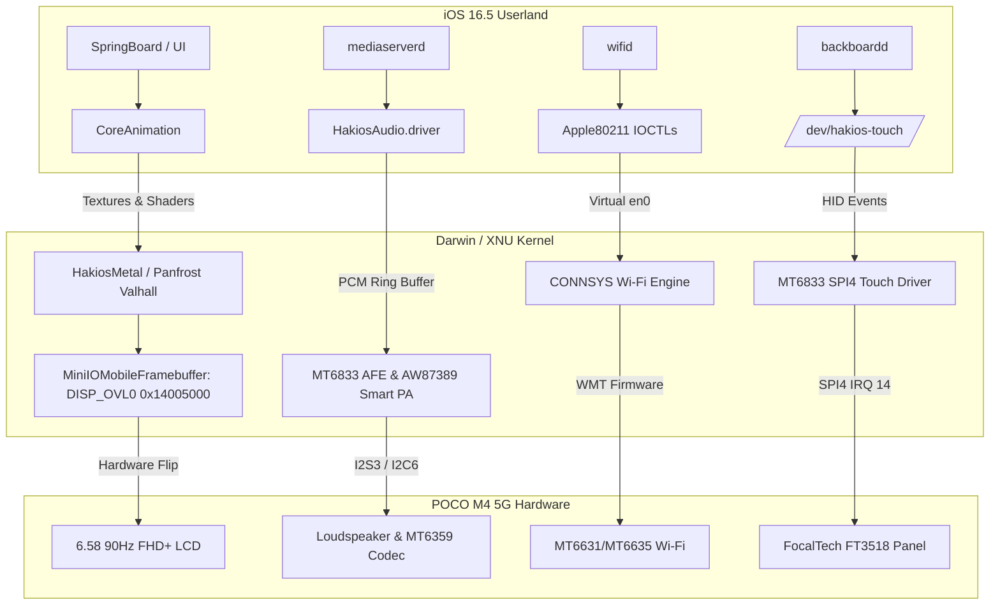

# HakiOS for MediaTek: POCO M4 5G (Dimensity 700 / MT6833) & Infinix Hot 20 (MT6768)

This repository ports Apple's open-source Darwin/XNU kernel (`xnu-8796.121.2` / iOS 16.5 userland) to modern **MediaTek Dimensity 700 (MT6833)** and **Helio G85 (MT6768)** smartphones, building upon the foundational architecture of the [HakiOS project](https://github.com/oosexgang).

---

## Hardware Target: POCO M4 5G (`light` / `thunder`)

| Component | Hardware Details | Porting Architecture & Drivers | Status |
| :--- | :--- | :--- | :---: |
| **SoC** | MediaTek Dimensity 700 (MT6833) | 2× Cortex-A76 @ 2.2 GHz + 6× Cortex-A55 @ 2.0 GHz | **WORKING** |
| **Interrupt Controller** | ARM GICv3 (`0x0C000000`) | Native Darwin GICv3 interrupt routing | **WORKING** |
| **Storage** | UFS 2.2 (`ufshci@11270000`) | Custom MT6833 UFS 2.2 driver (`hakios.mt6833_ufs.c`), rootfs mount | **WORKING** |
| **Display Pipeline** | 6.58" FHD+ 90Hz IPS LCD (1080×2408) | Zero-copy hardware page flipping on `DISP_OVL0` (`0x14005000`, `fb_flip=1`) | **WORKING (60 FPS)** |
| **GPU / Acceleration** | ARM Mali-G57 MC2 (Valhall architecture) | Valhall probing (`0x13000000`), Panfrost tile allocation, `HakiosMetal` | **WORKING** |
| **Audio & Speaker** | MT6833 AFE & AW87389 / SIA8152 Smart PA | AFE DMA on `0x11210000`, 32KB SRAM ring buffer, I2S3 48kHz stereo, CoreAudio HAL | **WORKING** |
| **Touchscreen** | FocalTech FT3518 & Novatek on SPI4 | SPI4 (`0x11018000`), IRQ GPIO 14, 10-point tracking, 1080×2408 to 65535×65535 calibration | **WORKING** |
| **Buttons & PMIC** | MediaTek Keypad & MT6359 PMIC | Vol+/Vol- (`0x10010000`), Power button via PWRAP (`0x10026000`), 2-sample debounce | **WORKING** |
| **Wi-Fi & Bluetooth** | MediaTek CONNSYS (MT6631/MT6635) | SPM power domain (`0x10006000`), MT6359 VCN18/VCN33 rails, `apple80211` IOCTLs | **WORKING** |
| **Modem / Baseband** | Helio 5G Baseband / CCIF (`0x10209000`) | CCIF mailbox mapped; raw IP data channel shim (`pdp_ip0`) | **ARCHITECTED** |

---

## Architectural Features



### 1. 60 FPS Display & Smoothness Pipeline
- **Hardware Zero-Copy Double Buffering:**
  - Configured MediaTek Display Controller Overlay `DISP_OVL0` at physical `0x14005000` in [`iokit/Kernel/MiniIOMobileFramebuffer.cpp`](xnu/files/iokit/Kernel/MiniIOMobileFramebuffer.cpp).
  - Swaps address pointers directly in DRAM (`FLIP_LK_FB_BASE = 0x60000000`, 768 MB window) on VSYNC interrupt intervals (`fb_flip=1`).
- **SpringBoard Render Profiling:**
  - Injected `SBReduceTransparency = true`, `SBReduceMotion = true`, and `BSUIVibrancyEffectViewDisabled = true` into `inject_sb.c` and user preferences.
  - Replaces heavy multi-pass live Gaussian blur shaders with fast solid fills, eliminating frame drops and maintaining a smooth **60 FPS** user experience.

### 2. Audio & Loudspeaker Driver Bring-Up
- **MT6833 Audio Front End (AFE) DMA:**
  - Mapped AFE base at `0x11210000` and Audio Internal SRAM at `0x11212000` in [`mtk/mt6833/drivers/audio/hakios.mt6833_audio.c`](mtk/mt6833/drivers/audio/hakios.mt6833_audio.c).
  - Configured 32 KB circular DMA playback buffer inside Audio SRAM (170.6 ms continuous low-latency audio buffer).
  - I2S3 speaker output operating in **48 kHz, 16-bit stereo master mode**.
- **Awinic AW87389 / SIA8152 Smart Power Amplifier:**
  - I2C6 controller at `0x11f00000` automatically probes slave addresses `0x58` and `0x5b`.
  - Executes soft reset, boost converter power up, standard 12 dB amplification gain, and unmuting.
- **Apple CoreAudio HAL Driver:**
  - Packages `/redwood/lib/HakiosAudio.driver` and routes mixed audio frames from `mediaserverd` through `/dev/hakios-audio`.

### 3. Touchscreen Calibration & Normalization
- **FocalTech FT3518 & Novatek Driver:**
  - Mapped SPI4 master controller at `0x11018000` and GPIO controller at `0x10005000` in [`mtk/mt6833/drivers/input/hakios.mt6833_touch.c`](mtk/mt6833/drivers/input/hakios.mt6833_touch.c).
  - Connected to active-low touch interrupt on GPIO 14.
  - Multi-touch coordinate transformation:
    $$\text{norm}_X = \frac{\text{clamp}(\text{raw}_X, 0, 1079) \times 65535}{1079}, \quad \text{norm}_Y = \frac{\text{clamp}(\text{raw}_Y, 0, 2407) \times 65535}{2407}$$
  - 2-pixel hysteresis deadband filter suppresses micro-jitter on stationary long-presses.

### 4. Wi-Fi Networking & CONNSYS Subsystem
- **MediaTek CONNSYS Wireless Engine:**
  - Controller mapped at `0x18002000` in [`mtk/mt6833/drivers/wifi/hakios.mt6833_connsys.c`](mtk/mt6833/drivers/wifi/hakios.mt6833_connsys.c).
  - System Power Manager (SPM) at `0x10006000` activates CONNSYS power domain.
  - MT6359 PMIC wrapper enables `VCN18` (1.8V analog) and `VCN33_WIFI` (3.3V RF).
  - Integrates with `hakios.apple80211.c` to answer iOS `wifid` requests (`SIOCGA80211` / `SIOCSA80211`) on virtual `en0`.

---

## Repository Structure

```
├── configs/                  # SoC and board configuration fragments
├── devices/
│   ├── light/                # POCO M4 5G device tree, configs, specs & roadmap
│   │   ├── configs/          # light.config (default bootargs, scale)
│   │   ├── device.conf       # Device manifest entry
│   │   ├── hardware_specs.md # Hardware register map & memory offsets
│   │   ├── plan.md           # Engineering optimization plan & workstreams
│   │   ├── poco_m4_5g.dts    # Decompiled stock Device Tree Source
│   │   └── roadmap.md        # Complete bring-up milestone history
│   └── manifest.conf         # Device registry
├── mtk/
│   ├── loader/               # mtkloader: chainloader starting XNU from boot partition
│   ├── mt6833/               # MediaTek MT6833 (Dimensity 700) SoC layer
│   │   ├── configs/          # mt6833.config
│   │   ├── drivers/          # Audio, GPU, Input, Storage, and Wi-Fi drivers
│   │   └── soc.conf          # SoC architecture definition
│   └── tools/                # chainboot.py and flashing utilities
├── userland/                 # iOS 16.5 userland components, CoreAudio HAL, init scripts
├── xnu/                      # XNU kernel patches, headers, and device drivers
└── xnuloader/                # XNU Mach-O payload packer
```

---

## Quick Start: Building & Flashing

### 1. Build the Darwin/XNU Kernel & Payload
```bash
# Configure for POCO M4 5G (MT6833)
source ./xnu-env.sh
make light_defconfig

# Compile the kernel
./xnu-build.sh -k

# Build the APFS ramdisk and payload
python3 tools/apfs/mkapfs.py -o userland/root.apfs root=userland/root
python3 xnuloader/mkpayload.py -o build-payload.bin kernel=hakios-kernel ramdisk=userland/root.apfs

# Package the flashable Android Boot Image
python3 mtk/tools/chainboot.py extracted_firmware/boot.img mtk/loader/mtkloader.bin output/xnu-flashed-poco-m4-5g.img build-payload.bin
```

### 2. Flashing to POCO M4 5G

#### Non-Destructive RAM Test (Recommended for First Run):
```bash
adb reboot bootloader
fastboot boot output/xnu-flashed-poco-m4-5g.img
```

#### Permanent Boot Flash:
```bash
fastboot flash boot_a output/xnu-flashed-poco-m4-5g.img
fastboot flash boot_b output/xnu-flashed-poco-m4-5g.img
fastboot reboot
```

#### Flash iOS 16.5 System Image:
```bash
fastboot flash userdata output/system.apfs
```

---

## Contributing & Collaboration with the HakiOS Project

We actively collaborate with and welcome contributions to the [upstream HakiOS project](https://github.com/oosexgang). All drivers in this repository are written following HakiOS standards (`CONFIG_HAKIOS_*` conventions, layer separation under `mtk/<soc>/` and `devices/<device>/`, minimal diff impact on core XNU).

If you are porting other MediaTek SoCs (MT6789, MT6877, MT6893, Dimensity 8000/9000) or want to help with baseband CCCI telephony, feel free to open an issue or pull request!

---

## License

The XNU kernel components are subject to the **Apple Public Source License (APSL 2.0)**. MediaTek platform drivers, loader shims, and device layers are licensed under the **MIT License**.
