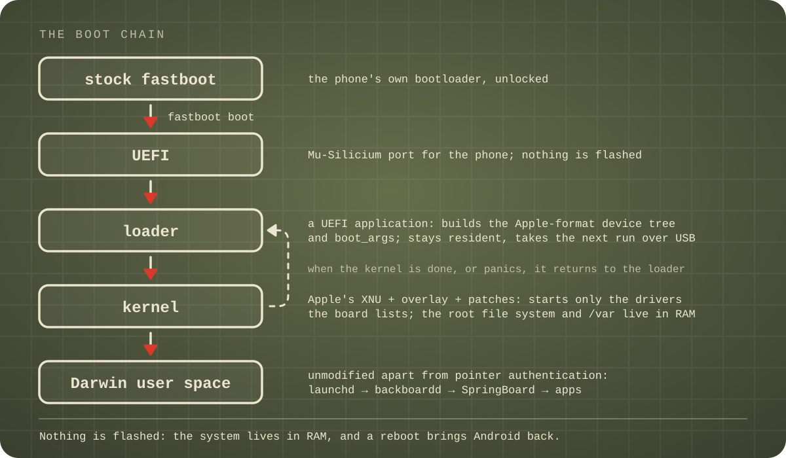

<p align="center">
  
</p>

<p align="center">
  在高通芯片手机上运行 Apple 开源 XNU 内核与 Darwin 用户态。
</p>

<p align="center">
  <a href="Documentation/architecture.md">架构</a> · <a href="Documentation/porting.md">移植</a> · <a href="Documentation/building.md">构建</a> · <a href="Documentation/drivers.md">驱动</a> · <a href="https://github.com/oosexgang/xnu-kernel-qcom/tree/devices">设备</a> · <a href="CONTRIBUTING.md">贡献</a>
</p>

<p align="center">
  <a href="https://github.com/oosexgang/xnu-kernel-qcom/actions/workflows/check.yml"></a>
  <a href="Documentation/README.md"></a>
  <a href="https://github.com/oosexgang/xnu-kernel-qcom/tree/devices"></a>
  <a href="https://t.me/oosexgangdevs"></a>
  <a href="kernel/UPSTREAM"></a>
</p>

<p align="center">
  <a href="README.md">English</a> | 简体中文
</p>

# HakiOS

HakiOS 在搭载高通芯片的 Android 手机上运行 Apple 开源 XNU 内核和 Darwin 用户态。不刷写任何内容：UEFI 通过
`fastboot boot` 启动，系统只在 RAM 中运行，重启后回到 Android。

> 实验性项目，需要解锁 Bootloader。本仓库的任何工具都不得刷写、擦除或写入手机存储。

本文是 [README.md](README.md) 的译文；如有出入，以英文版为准。其余文档目前只有英文。

本分支是项目本身，适用于任何手机：内核、引导器、工具，以及每种已支持芯片的描述。它不包含任何具体
手机。一部手机是一个**设备包**——保存在 [`devices` 分支](https://github.com/oosexgang/xnu-kernel-qcom/tree/devices)
上的一个小目录，一条命令即可把它带入检出。

## 这里有什么

- **所有板型共用一个内核。** 启动时识别板型；驱动只在板型文件列出它时才启动，因此从未被描述过的机器
  不会被写入。
- **板型即数据。** 一部手机是一个 TOML 文件，其芯片是另一个。地址、引脚、固件目录和启动默认值都在
  其中，而不在驱动里。工具可从手机的 Android 设备树生成这两个文件的初稿，并说明接下来可以启用什么。
- **设备包。** 手机与代码分开保存。内核、引导器和库按当前存在的设备包构建。
- **不需要手机的检查。** 驱动在主机上对照硬件模型运行（在 sanitizer 下），移植指南在一部虚构的手机上执行，
  内核源码对照 Apple 的发布进行验证并做语法、类型和打印格式的编译检查，每次推送都会运行。
- **QEMU 中的内核。** 内核像在手机上一样在模拟器中启动，进入它自己的 shell，并在那里检查网络、磁盘、
  文件、声音、输入、进程、线程、内存、IOKit 和屏幕，以及 BSD 要求内核对用户、程序和文件系统拒绝的操作；
  它在那里也运行内核自身的测试，并在四个和一个处理器上启动（[Documentation/qemu.md](Documentation/qemu.md)，`make qemu`）。
- **固定版本的输入。** 从外部获取的所有内容都在 [`components/upstream.dts`](components/upstream.dts) 中，精确到版本。

## 启动过程

<p align="center">
  
</p>

各部分如何配合，见 [Documentation/architecture.md](Documentation/architecture.md)。

## 设备

手机以设备包的形式与代码分开，存放在
[`devices` 分支](https://github.com/oosexgang/xnu-kernel-qcom/tree/devices)上：该分支的 README 列出了各部手机及其进度，
每个设备包自己的 README 说明在该手机上哪些可用、哪些已编写但尚未在真机验证、哪些仍关闭。本分支不描述任何手机；
它包含 QEMU `virt` 板（`devices/qemu-virt/`），当前内核可在其上启动到它自己的 shell，并在那里测试网络、磁盘、声音、
输入、进程、线程、文件、IOKit 和屏幕（[Documentation/qemu.md](Documentation/qemu.md)）。每个设备包都带有其芯片的
SoC 文件；目前的设备包涵盖 SM7350 和 SM7325，以及 SM8845 的最初几个模块。

## 快速开始

```sh
git clone https://github.com/oosexgang/xnu-kernel-qcom.git
cd xnu-kernel-qcom
make check                        # 所有不需要手机的检查
make kernel-check                 # 用 LLVM 的工具编译内核的每个文件并链接（见 Documentation/building.md）

tools/device.py available         # 已有设备包的手机
tools/device.py add renoir        # 带入一个（devices/renoir）
tools/boards.py status renoir     # 已启用什么，接下来可以启用什么
```

然后构建：[Documentation/building.md](Documentation/building.md)。尚无设备包的手机：[Documentation/porting.md](Documentation/porting.md)。

## 从这里开始

| 你想要 | 阅读 |
| --- | --- |
| 了解整体结构 | [Documentation/architecture.md](Documentation/architecture.md) |
| 移植到自己的手机 | [Documentation/porting.md](Documentation/porting.md) |
| 构建内核或引导器 | [Documentation/building.md](Documentation/building.md) |
| 查某个驱动或启动参数的作用 | [Documentation/drivers.md](Documentation/drivers.md)、[Documentation/boot-args.md](Documentation/boot-args.md) |
| 为还没有驱动的器件写驱动 | [Documentation/writing-a-driver.md](Documentation/writing-a-driver.md) |
| 查日志里某条信息的含义 | [Documentation/troubleshooting.md](Documentation/troubleshooting.md) |
| 了解板型和设备包如何描述 | [devices/README.md](devices/README.md) |
| 修改并提交 | [CONTRIBUTING.md](CONTRIBUTING.md) |
| 迁移旧目录结构下的分支或补丁 | [Documentation/migrating.md](Documentation/migrating.md) |
| 了解这次重构改了什么 | [CHANGELOG.md](CHANGELOG.md) |

## 目录

| 路径 | 内容 |
| --- | --- |
| `devices/` | 模板、模拟器的设备包，以及你带入的设备包：每个包含一个板型文件和其芯片的 SoC 文件。 |
| `kernel/` | 内核：固定版本的 Apple 发布、HakiOS 新增的文件（`overlay/`）、对 Apple 文件的修改（`patches/`），以及组装、检查和构建工具。 |
| `arch/arm64/boot/` | 启动 arm64 内核的部分，放在 Linux 源码树放它的位置：UEFI 应用（加载器），生成 Apple 设备树并常驻以接收内核日志，以及打包载荷和手机启动镜像的工具。 |
| `darwin/` | Darwin 26/27 用户态所需：注入少数进程的库、PAC 重写工具、镜像构建工具、启动工具。 |
| `userland/` | 仍在使用或正在移植的早期用户态源码：init、注入 Darwin 程序的库、APFS 镜像工具。 |
| `workbench/` | 主机测试：内核中与设备无关的驱动（对照硬件模型）以及各工具。 |
| `tools/` | `boards.py`（板型文件）及 `devicetree.py`（从手机设备树读取的内容）和 `qupclocks.py`（从 Linux 时钟驱动中读取串行引擎的时钟）、`device.py`（设备包）、`bootargs.py`（生成的参考文档）、lint 与发布检查。 |
| `components/` | 让 Darwin 某个子系统工作的移植部分，各占一个目录：Metal（第二个 Metal 设备在 `metal/plugin`）、Apple ID 与 App Store、SEP 的密钥库、相机、声音、亮度、壁纸、状态栏、插件（tweaks）；`components/upstream.dts`：从外部获取的所有内容及其固定版本。 |
| `build.config.*` | 构建是什么：`build.config.common` 为全部共用，`build.config.arm64` 为内核（由 `kernel/env.sh` 读取，或读取 `BUILD_CONFIG` 指定的文件），`build.config.darwin27` 为 Darwin 镜像，`build.config.bench` 为在手机上的一次运行。环境变量中的值优先。 |
| `bench` | 工作台上的手机：启动常驻加载器、发送镜像、运行内核、取回日志、截图和录屏（`./bench state`、`./bench run`）。 |
| `Documentation/` | 文档。 |
| `legacy/` | 第一代工作区（Darwin 16.5）。保留尚未迁移的部分：UEFI 移植、Wi-Fi 兼容层、QEMU 脚本。 |

## 一段话说明移植

一部手机由一个板型文件描述，其芯片由同目录下的 `soc.dtsi` 描述。
`tools/boards.py new NAME --soc SOC --dts phone.dts` 可从手机的 Android 设备树生成这两个文件的初稿。
内核只在列出了相应驱动的板型上启动该驱动，因此新手机一开始只有显示，之后逐行增加硬件；
`tools/boards.py status NAME` 会说明接下来可以启用什么，以及其余各项还缺什么；
`tools/boards.py compare NAME --dts phone.dts` 可随时把这两个文件与设备树逐项对照。
芯片各模块的地址来自 SoC 文件，而不是写死在驱动代码里
（唯一的例外是触摸控制器所接的串口，它写在该器件的驱动里）。
尚无驱动的器件（触摸控制器、功放等）需要另写驱动，可从一个随其余部分一起构建并测试的示例入手
（[Documentation/writing-a-driver.md](Documentation/writing-a-driver.md)）。可用之后，设备包提交到 `devices` 分支。
指南见 [Documentation/porting.md](Documentation/porting.md)。

## 不在本仓库中的内容

Apple 的文件（XNU 在构建时获取；Darwin 来自你本机上的 Apple IPSW）、手机固件（取自同一部手机）以及第三方工具链。
此外，目前启动 Renoir 所用的常驻引导器和镜像工具位于团队尚未公开的工作树中：在其公开之前，
无法从一份干净的检出复现 Renoir 的启动。详见
[Documentation/architecture.md](Documentation/architecture.md#what-is-not-in-this-repository)。

## 社区

新闻与进展：[t.me/oosexgangdevs](https://t.me/oosexgangdevs)。问题、缺陷和新手机：本仓库的 issue 与
pull request；[CONTRIBUTING.md](CONTRIBUTING.md) 说明各类修改应放在哪里。

## 许可证

见 [NOTICE.md](NOTICE.md) 和各源码文件头。Apple 系统文件、SDK、设备固件及构建镜像均为本地构建输入／输出，
不属于仓库内容；`tools/check-publishable.sh` 会检查它们。

## 致谢

- [HakiOS](https://github.com/oosexgang/hakios-xnu-kernel)
- [Data A Live](https://github.com/ShueiTsuki/data-a-live)
- [Mesa](https://mesa3d.org/)
- [Project Silicium / Mu-Silicium](https://github.com/Project-Silicium/Mu-Silicium)
- Apple 开源 XNU 和各源码文件中注明的 Linux 驱动

Apple、Darwin、Metal 是 Apple Inc. 的商标。本项目与 Apple、高通、小米均无关联。
