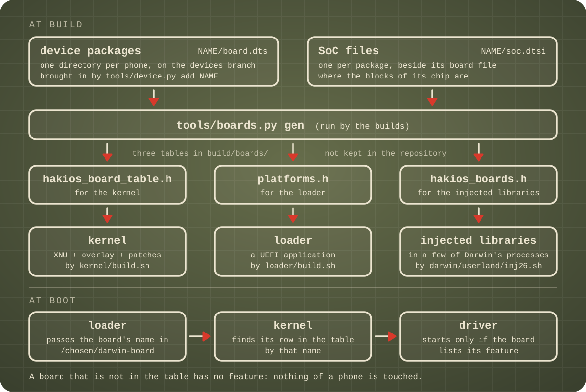

# Devices

A device is described by data, in two places:

| What | Where | What it says |
| --- | --- | --- |
| A **device package** | `NAME/board.toml`, with the phone's README and notes beside it | What the device has: its SoC, the drivers it may start (`features`), its panel's brightness control (`[backlight]`), thermal floors (`[thermal]`), its keys, audio DSP, GPU and Wi-Fi radio (`[buttons]`, `[adsp]`, `[gpu]`, `[wifi]`), what iOS's interface is told of its screen (`[screen]`), how the loader recognises it (`[loader]`), its default boot arguments (`[boot]`). |
| A **SoC file** | `soc/SOC.toml` | Where the blocks of the chip are, once for every board with that chip: the interrupt controller and cores (`[platform]`), clock controllers (`[clocks]`), the DSI controller (`[display]`), the PMIC arbiter (`[spmi]`), RPMh (`[rpmh]`), the GPU's blocks (`[adreno]`), temperature sensors (`[thermal]`), the CPU frequency block and its groups of cores (`[cpufreq]`). |

`devices/_template/board.toml` and `devices/_template/soc.toml` explain every key.

## Where packages are kept

This branch describes no phone. It has the emulator's board (`devices/qemu-virt`), the templates, and
the SoC files, which are shared. Phones are packages on the repository's
[`devices` branch](https://github.com/oosexgang/xnu-kernel-qcom/tree/devices): one directory each, with
nothing of the code. They change at their own pace, and a phone can be added there without touching
the kernel.

```sh
tools/device.py available               # the packages the devices branch has
tools/device.py add renoir              # bring one into this checkout: devices/renoir
tools/device.py list                    # what is here, and where each is from
tools/device.py remove renoir           # take it out again
tools/device.py add mido --from ../my-packages      # from a directory, or another branch or commit
tools/device.py export mido ../hakios-devices       # a package made here, to a checkout of the devices branch
```

A package that was brought in lies in `devices/NAME/`, which git ignores here: it is changed where it
is kept, not in a checkout of the code. Packages are also found in any directory named by
`tools/boards.py --devices DIR` or the environment variable `HAKIOS_DEVICES` (written as `PATH` is),
so a checkout of the `devices` branch beside this one works without copying anything:

```sh
git worktree add ../hakios-devices devices
export HAKIOS_DEVICES=$PWD/../hakios-devices
```

## What is made of them



```sh
tools/boards.py list                    # the boards that are here
tools/boards.py show renoir             # one board with its SoC's values
tools/boards.py status renoir           # what it has on, what it could turn on, what the rest waits for
tools/boards.py check                   # validate everything; says which file and why
tools/boards.py new NAME --soc SOC --dts device-tree.dts    # start a new board from an Android device tree
```

`tools/boards.py gen` writes three tables into `build/boards/`, for the boards that are there:

- `hakios_board_table.h`, the kernel's. At boot the kernel looks up the name the loader passed in
  `/chosen/darwin-board`. Drivers ask `hakios_board()` for addresses and
  `hakios_board_has(HAKIOS_HAS_...)` before they start (`hakios_board.h` lists the features). A board
  that is not in the table gets no feature: nothing of a phone is touched on a machine nobody described.
- `platforms.h`, the loader's, for the boards with a `[loader]` section. The loader tells them apart by
  the framebuffer address their UEFI reports.
- `hakios_boards.h`, what the libraries injected into iOS's processes know of a board (`[screen]`).
  They read the board's name from `/chosen/darwin-board` in the registry.

None of the three is kept in the repository. The builds make them (`kernel/build.sh`,
`loader/build.sh`, `ios/userland/inj26.sh`), so what is built knows exactly the boards whose packages
were present: bring the package in, then build. The tests make their own, with two stand-in phones
(`tests/devices`).

`sysctl hw.board` shows what the running kernel found: `name`, `soc`, `description`, `features`.

## Adding a phone

The whole procedure, with what to take from the device tree and in which order to try the drivers, is
[docs/porting.md](../docs/porting.md). In short:

1. `tools/boards.py new NAME --soc SOC --dts your.dts` and fill in what it could not read.
2. `tools/boards.py check`, then `tools/boards.py status NAME`.
3. Make the loader pass `darwin-board = "NAME"`.
4. Boot with features off, then enable them one at a time.
5. Send the package (`devices/NAME/`, with a README that says what works) to the `devices` branch:
   `git worktree add ../hakios-devices devices`, then `tools/device.py export NAME ../hakios-devices`
   and commit it there. A SoC file that is new goes to this branch, in `soc/`.

Drivers that are specific to one device's parts (a touch controller, a speaker amplifier) are code,
not data: they live in `kernel/overlay/bsd/dev/` and are started for the boards that have the part.

## Adding a kind of data

When a driver needs something of a device that no section has yet (an address, a pin, a firmware
directory), it becomes a key, not a constant in the driver. The `[spmi]` and `[buttons]` sections are a
small example to copy; each step is one place:

1. **The kernel's struct.** A field in `struct hakios_board` (`kernel/overlay/bsd/dev/hakios_board.h`),
   with a comment that says which file and section it comes from.
2. **The schema.** The key and its type in `SOC_SCHEMA` or `BOARD_SCHEMA` of `tools/boards.py`: what
   every board with the chip shares goes in the SoC file, what one phone has goes in the board file.
   If a feature cannot work without the section, say so in `FEATURE_NEEDS` or
   `FEATURE_NEEDS_OF_BOARD`; values that can be wrong in a way worth catching get a check in `load()`.
3. **The table.** A line in `table_text()` that writes the field.
4. **The files.** The key explained in `devices/_template/`, the values in the tests' phones
   (`tests/devices`) where a test needs them, and in the packages that have them, on the `devices`
   branch, each with a comment naming where in the device tree or in Linux it is from.
5. **The device tree**, if the value is in one: `from_dts()` in `tools/devicetree.py`, so that
   `tools/boards.py new --dts` fills it in for the next phone.
6. **The driver** reads `hakios_board()->…` and says so in its log when the data is missing, rather
   than falling back to one phone's value.
7. **Tests.** `tests/boards_test.py` for what the tool takes and refuses, `tests/board_test.c` for what
   the kernel sees. `make check` also fails while the template does not explain a key the schema has.

A key that a feature needs is a change the packages have to follow: say so in the pull request, so
that the `devices` branch gets it at the same time.
