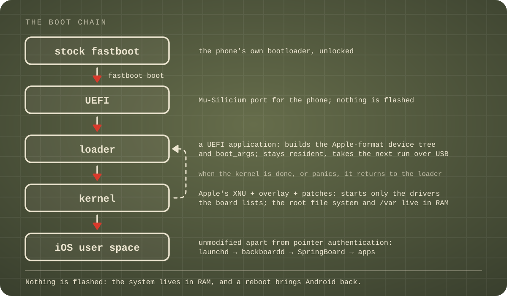
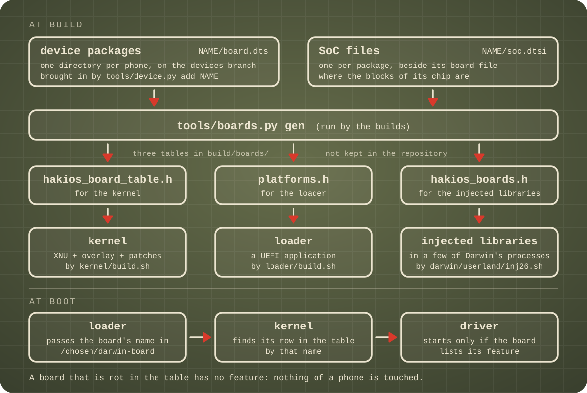

# Architecture

How the pieces fit together, and where each one lives in the repository. Read this before changing
anything; [porting.md](porting.md) is the step-by-step guide for a new device.

## The boot chain



In more detail:

```
stock fastboot ──"fastboot boot"──► UEFI (Mu-Silicium port for the phone; nothing is flashed)
                                      │
                                      ▼
                         loader (loader/, a UEFI application)
                           - finds its board by the framebuffer the UEFI reports
                           - builds the Apple-format device tree and boot_args
                           - passes the board's name in /chosen/darwin-board
                           - stays resident: receives the kernel's log, takes the next run over USB
                                      │
                                      ▼
                         kernel (kernel/: Apple's XNU + overlay + patches)
                           - looks its board up in the generated table (hakios_board())
                           - starts only the drivers the board lists and the boot-args ask for
                           - the root file system and /var live in RAM
                                      │
                                      ▼
                         Darwin user space, unmodified apart from pointer authentication
                           - launchd → backboardd → SpringBoard → apps
                           - small libraries of ours are inserted into a few processes (darwin/userland/)
```

When the kernel is done, or panics, it returns to the loader, which still holds the phone's USB link.
A reboot brings Android back.

## Three layers, three kinds of change

| Layer | Where | Changes when |
| --- | --- | --- |
| **Device data** | A device package per phone (`NAME/board.dts` and `NAME/soc.dtsi`, kept on the `devices` branch) | A new phone, or a new SoC. No code. |
| **Drivers for parts** | `kernel/overlay/bsd/dev/`, `kernel/overlay/iokit/Kernel/` | A phone has a part nobody wrote a driver for yet (a touch controller, an amplifier). |
| **The port itself** | `kernel/patches/`, the rest of `kernel/overlay/`, `loader/`, `darwin/` | Apple's kernel or Darwin changes, or the port learns something new. Same for every device. |

The aim is that a new phone, on a known SoC or a new one, is a change to the first row only. Where that is not yet true, [drivers.md](drivers.md) says so driver by driver.

## Device data



```
device packages                     tools/boards.py gen        build/boards/board_table.h  (the kernel's table)
  (NAME/board.dts, NAME/soc.dtsi) ──────────────────────►      build/boards/platforms.h           (the loader's)
  from the devices branch, or any    (run by the builds)        build/boards/user_boards.h       (the injected libraries')
  directory on the search path
```

- The repository describes no phone. `devices/` on the main branch has the emulator's board
  (`devices/qemu-virt/`) and a template (`devices/_template/`).
- A phone is a **device package**: a directory `NAME/` with its `board.dts`, its `soc.dtsi`, its README
  and its notes.
  Packages are kept on the `devices` branch, one directory per phone.
  `tools/device.py add renoir` (or `make device DEVICE=renoir`) copies one into `devices/NAME/` of a
  checkout, which git ignores there: a package is changed where it is kept. `tools/device.py available`
  lists what the branch has, `list` what is here, `remove` takes one out, and `--from SOURCE` takes
  packages from a directory or another branch or commit.
- `tools/boards.py` looks for packages in `devices/`, in `--devices DIR` and in the directories of the
  environment variable `HAKIOS_DEVICES` (written like `PATH`).
- A **board file** says what the device has: its SoC, the drivers it may start (`features`), how its
  panel's brightness is set, thermal floors, how the loader recognises it, its default boot arguments.
- A **SoC file** says where the blocks of the chip are: interrupt controller, cores, clock
  controllers, DSI controller, temperature sensors, the CPU frequency block, the SoC's pins, the PMIC
  arbiter, RPMh, the SMMU, the way to its other processors, the storage controller, the camera's and
  the audio subsystem's blocks. Each package carries its own copy: two phones with one chip have the
  same file, and `tools/boards.py new` copies it from a package that has it. The drivers take these addresses from it; the one address still in a driver's
  code is the serial port a touch controller is wired to, which is that part's wiring.
- `tools/boards.py new` starts both files from a phone's Android device tree, and
  `tools/boards.py compare` holds them against one later.
- The generated files are not committed. `tools/boards.py gen` writes them into `build/boards/`
  (ignored by git) or into the directory given with `--out`, and every build runs it itself, some into
  a directory of their own: `kernel/build.sh` (which puts the kernel's table
  into the assembled tree as `bsd/dev/board/board_table.h`, only when it changed), `loader/build.sh`,
  `darwin/userland/inj26.sh`, `kernel/syntax-check.sh` and `workbench/run.sh`. So the kernel, the loader and
  the libraries know the boards whose packages were present when they were built, and the data and the
  code cannot drift apart. Built with no package, they know only the emulator's board.
- The host tests do not use real phones. They run against four stand-ins in `workbench/devices/`:
  `phone-cmd` (a command-mode panel on sm7350), `phone-video` (a video-mode panel on sm7325, every
  part driver listed), `phone-keys` (on a made-up chip, with its parts on other pins and buses than the
  first two: the test of a part's driver runs it there too, so a value of one phone left in the code
  shows) and `phone-scmi` (a made-up chip whose cores' speeds are the firmware's, over SCMI).
- At boot the kernel finds its row by `/chosen/darwin-board`. A driver asks
  `hakios_board_has(HAKIOS_HAS_…)` before it starts and reads addresses from `hakios_board()`.
  A board that is not in the table has no feature: nothing of a phone is touched on a machine nobody
  described.

Details and every key: [devices/README.md](../devices/README.md), `devices/_template/board.dts` and
`devices/_template/soc.dtsi`.

## The kernel

| Path | Contents |
| --- | --- |
| `kernel/UPSTREAM` | The Apple release, pinned by commit. |
| `kernel/overlay/` | The files HakiOS adds, as ordinary sources at their place in the XNU tree. |
| `kernel/patches/` | The changes to Apple's own files, as 7 patches by topic (`kernel/verify.sh` prints how many files each side has). |
| `kernel/assemble.sh`, `export.sh`, `verify.sh` | Make the tree that is compiled; take work back; check the round trip. |
| `kernel/syntax-check.sh` | Compile what HakiOS adds for syntax, types and the formats of what it prints, with any clang. |
| `kernel/build.sh`, `deps/`, `host/`, `iig-impl/` | The build on Linux. |

What the overlay provides, in the order a boot meets it:

1. **Platform** (`osfmk/arm64/`): GICv3 interrupts, PSCI for the other cores, the return to the
   loader with the log, emulation of the few arm64e instructions an ARMv8.2 core lacks.
2. **Stand-ins for Apple's closed kernel extensions** (`iokit/Kernel/`, `libkern/amfi/`,
   `osfmk/minicrypto/`): the platform expert, IOSurface, IOMobileFramebuffer, AppleKeyStore, the
   network stack's registry side, code-signing policy, crypto.
3. **File systems** (`bsd/miscfs/apfs/`, `ramfs/`): an APFS implementation that reads the Darwin images
   from RAM, and the RAM file system for `/private/var`.
4. **Drivers** (`bsd/dev/`): display and GPU, touch, buttons, battery, sound, camera, Wi-Fi, storage,
   CPU frequency, backlight, thermal. Each does nothing until its boot argument asks. All of them
   are started from one list, `bsd/dev/board/drivers.c`, which `bsd_init()` calls once: the list
   has no knowledge of any board, a driver decides for itself whether it has anything to do.
5. **What the drivers share** (the headers of `bsd/dev/board/`): the board's data, the log, registers, waits,
   the SoC's pins, the PMIC arbiter's protocol, RPMh's command database and a request to it, the
   way to the other processors (their shared memory, SMP2P, GLINK's queues and messages, QRTR's
   framing, a DSP's firmware image, the mailbox). What another processor sends is checked there, once,
   rather than in each driver that talks to one. Each is written once and, where it has logic, tested
   on the host;
   [writing-a-driver.md](writing-a-driver.md) lists them.

Naming: what the port adds to the kernel lives in `board/` directories (`bsd/dev/board/`,
`bsd/sys/board/`) or beside Apple's files under its own name (`iokit/Kernel/BoardGPU.cpp`,
`osfmk/arm64/psci_smp.c`); the symbols are `hakios_*` (`/dev/hakios-touch`, the `HakiosGPU` service).
Files are named for what they do; a driver of one part is named after the part. No name in the code
says which phone it is for: that is the board's to say.

More: [kernel/README.md](../kernel/README.md), [kernel/patches/README.md](../kernel/patches/README.md).

## The loader

The loader is one compilation unit, `loader/loader.c`, made of parts by topic in `loader/src/`: UEFI
glue, the payload format ("XNUP": kernel + images + boot arguments), the device tree it builds for
XNU, the kernel's memory, the USB link, the phone's storage. It needs nothing of EDK2 to build.
Its knowledge of machines is `platforms.h`, which `loader/build.sh` generates from the device packages
that are present. No phone is named in its code: what differs between boards, down to whether the battery
is read through the firmware's Qualcomm charger protocols (`uefi-charger`), is in the board file's
`loader { }` section.
More: [loader/README.md](../loader/README.md).

## Darwin user space

Darwin's own programs and frameworks are used as Apple ships them, with one transformation: on CPUs
without pointer authentication, `darwin/tools/pacstrip.c` rewrites PAC instructions to their plain
equivalents and re-signs the pages.

| Path | Contents |
| --- | --- |
| `darwin/userland/inject_*.c` | Libraries inserted into single processes by the kernel (`kern.exec_inject`): display-mode completion and panel power, brightness, the first wallpaper, the status bar's clock. Each checks the method it replaces and leaves it alone if it is not what it expects. |
| `darwin/userland/*.sh` | Build those libraries and the small root image. |
| `darwin/tools/` | `pacstrip`, the system image builder (`mkimage26.py`), the FIPS self-test fix, the RAM budget tools, the boot tool (`boot26.py`). |
| `userland/` | The earlier generation's user-space sources that are still used or still being ported: `init`, the audio plug-in, the Metal device, the AIR-to-NIR shader compiler for Mesa, the APFS image tools. |

How Darwin 26 and 27 were brought to the home screen, step by step: [darwin26-boot.md](darwin26-boot.md).

## What is not in this repository

Being honest about this is part of the architecture: these are the inputs a build or a boot needs
from elsewhere. Everything that is fetched is pinned to an exact version, listed in one place:
`components` at the top of the repository (`tools/components.py` prints it, and the lint checks it
against the scripts that fetch).

| What | Why not here | Where it comes from |
| --- | --- | --- |
| Apple's XNU release | It is Apple's; only the pin is kept. | `kernel/assemble.sh` fetches it. |
| Darwin itself (IPSW contents) | Apple's files are never redistributed. | Extracted on your machine from Apple's IPSW. |
| The phone's firmware (GPU, DSP, touch) | The vendor's; taken from the same phone it runs on. | `adb pull` from its Android. |
| theos (cctools linker, iPhoneOS SDK) | A third-party toolchain. The kernel can be linked with LLVM's own Mach-O tools instead, with the SDK's headers alone ([building.md](building.md)); the `darwin/` scripts need theos. | [theos.dev](https://theos.dev/docs/installation-linux) |
| The UEFI for a phone | A port of Mu-Silicium per device. | `base/uefi/` has the changes every port needs; a phone's own port is in its package. |
| **Renoir's resident loader, its recovery payload tool and the user-space root tree** | They live in the team's working tree (`darwin-renoir`), which has not been published. | Not available yet. `darwin/tools/boot26.py` and the `darwin/userland/*.sh` scripts need it. |

The last row is the gap between this repository and booting Renoir from a clean checkout.
Everything under `make check` and the kernel build itself do not depend on it.

A phone's device package is in the repository, but not on the main branch: `tools/device.py add NAME`
brings it into a checkout from the `devices` branch ("Device data" above).

## Legacy

`base/` is the workspace of the first generation: Darwin 16.5 on the first phone and QEMU, with
its own README, scripts and porting notes. Parts of it are still the only place for something (the
UEFI port, the Wi-Fi compatibility layer, the QEMU scripts) and are waiting to be brought to the
current kernel. What in it was one phone's own -- its xnu-8796 kernel, superseded by `kernel/`, its UEFI
platform and device profile -- is in that phone's package on the `devices` branch, under `legacy/`.
