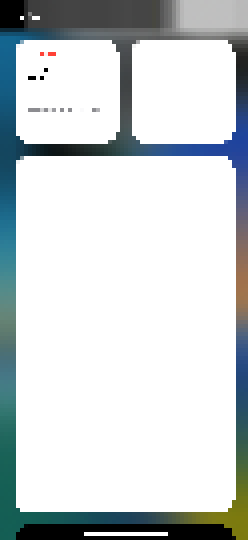

# The system wallpaper on the Infinix (X6826B)

iOS draws its own wallpaper here since run 273 (27 October 2026): PosterBoard and its poster
extensions run, CollectionsPoster draws the iOS 16 wallpaper (7400, WWDC 2022) with all its layers,
mediaserverd decodes the HEIC pictures. 

Until then the space behind the icons was black, and a picture drawn on the Mac
(`/redwood/share/wallpaper.jpg`, src/inject_sb.c `put_wallpaper`) stood in for the wallpaper.

## The image

```
INJECT='/redwood/lib/libredwood.dylib backboardd containermanagerd containermanagerd_system
/redwood/lib/libredwood-sb.dylib SpringBoard CollectionsPoster PosterBoard PaperBoard
/redwood/lib/libredwood-media.dylib mediaserverd' \
ANGELS="com.apple.PosterBoard com.apple.PaperBoard" \
MORE_JOBS="com.apple.mediaserverd com.apple.nanoregistryd com.apple.nanoprefsyncd" \
./runkit/mk.sh
```

and boot-arg `sb_wallpaper=0` (no picture over it). com.apple.mediaremoted, which it needs as well (run 328), is
among the stock jobs. The picture from the Mac can be left out of the
image (`root/share/wallpaper.jpg`): the boot partition has 12 KB to spare without it.

## What was in the way, in order

| Run | What the log said | What was done |
| --- | --- | --- |
| 246 | no PosterBoard process at all | launch angels are hidden from launchd (src/init.c): `ANGELS` puts chosen ones among the jobs (mkjobs.py) |
| 250 | SpringBoard's wallpaper window hosts the posters' contexts over a grey layer; the screen is black | (the posters draw black) |
| 255 | in CollectionsPoster the wallpaper's layer is a 1 x 1 picture over black | |
| 256 | "No compatible wallpaper found on disk (wallpaperIdentifier: '7400' ...)": the wallpaper exists for @3x screens only, this one is 375 x 812 at scale 2 | `-[NSUserDefaults wk_ignoreLogicalScreenClassForWallpaperBundle]` answers yes (inject_sb.c; `wk_screenclass=1` to leave it) |
| 258 | launchd kills CollectionsPoster: "Extension is hanging on launch" | |
| 259 | its main thread waits in `VTTileDecompressionSessionCreate` for mediaserverd | without mediaserverd: the wallpaper's gradient only (run 260) |
| 248, 253 | with mediaserverd SpringBoard puts two frames up: its main thread waits for mediaserverd in `FigSystemControllerRemoteCreate` | |
| 267 | `kern.redwood.ustack` (psgrep -stack): mediaserverd's main thread waits for ever in NanoRegistry (from NanoPreferencesSync) | nanoregistryd and nanoprefsyncd among the jobs |
| 269 | mediaserverd aborts at every start: AppleCVAPhoto (CMCapture) asks Metal for a library at a nil URL, "url must not be nil" | the Metal driver answers a nil URL with an error (redwoodmetal.m) |
| 272 | mediaserverd restarted over and over: "failed activation" of the Mach services `TRIM` had taken from it | all its services kept (`TRIM` is not wanted any more) |
| 273 | the whole wallpaper, mediaserverd up the whole run, 94% of busy frames within 18 ms | |
| 320 | "unusable": 10–26 MB free, jetsam killing; the system image held 2.4 GB of memory | the image read off the eMMC (docs/x6826b-emmc.md) |
| 324 | all four cores busy on the idle home screen, SpringBoard 220% | |
| 328 | SpringBoard's MediaRemote spinning: no mediaremoted | com.apple.mediaremoted among the stock jobs: 10% CPU (run 330) |

## Tools made on the way

- `kern.redwood.ustack=PID` and `psgrep -stack WORD`: a process's threads by the kernel, with the
  shared cache's slide; `tools/cache-name.py` names the addresses by the cache's images.
- `psgrep WORD...`: processes by path, with state and flags, short enough for the kept lines.
- `rwtouch notify com.redwood.wallpaper_layers`: SpringBoard's wallpaper windows (and, in a program
  given libredwood-sb, all its windows) as kept lines.
- `poster_log=1`: a poster's os_log errors kept, its faults and a main thread stuck for 3 s said by symbol.
- SpringBoard's hang watch: its main thread's stack when it has not answered for 20 s
  (`sb_hangwatch=0` to leave out).
